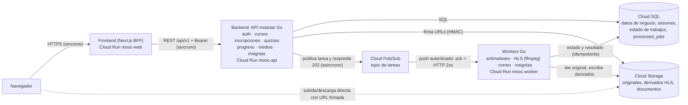
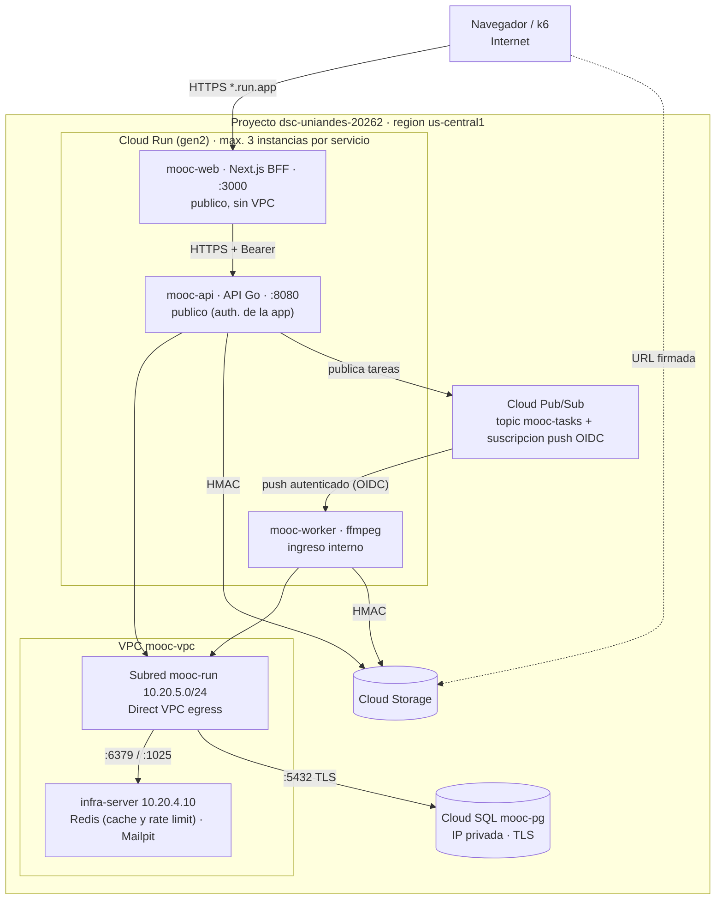

# Entrega 4 - Despliegue en Cloud Run y Cloud Pub/Sub

ISIS4426 - Desarrollo de Soluciones Cloud · Universidad de los Andes · 2026-20

Este documento describe el despliegue de la plataforma MOOC sobre **Cloud
Run** y la integración de **Cloud Pub/Sub** para las tareas asíncronas, y
los cambios frente a la Entrega 3. La arquitectura lógica de la aplicación
(módulos, reglas de negocio, modelo de datos) no cambia y sigue en
[`../entrega1/ARQUITECTURA.md`](../entrega1/ARQUITECTURA.md).

> **Estado del documento (actualizado 14-11-2026).** La Entrega 4 está
> **desplegada y operando** en Cloud Run con Cloud Pub/Sub:
>
> - **Tres servicios en Cloud Run:** `mooc-web`, `mooc-api` y `mooc-worker`
>   (el worker ya es el servicio *push*, no el temporal), con URLs
>   `https://<servicio>-mhuknn2hva-uc.a.run.app`.
> - **Cloud Pub/Sub es la cola:** la API publica en el topic `mooc-tasks` y la
>   suscripción push autenticada (`mooc-tasks-push`, token OIDC, ackDeadline
>   600 s) entrega cada mensaje al worker, que confirma tras persistir.
>   Verificado end-to-end el 14-11-2026 (push `POST 204`, token OIDC validado).
> - **Redis ya no es la cola:** permanece en `infra-server` solo para caché de
>   sesiones y límite de tasa.
>
> El historial de fases (Fase 1 con Redis/worker-temporal como puente) se
> conserva en la sección 6.1 como referencia. La configuración efectiva se
> consulta con `./deploy/gcp/cloudrun.sh resumen`.

Documentos relacionados: arquitectura de la Entrega 3
([`../entrega3/arquitectura.md`](../entrega3/arquitectura.md)) y deuda técnica
([`../entrega3/deuda-tecnica.md`](../entrega3/deuda-tecnica.md)).

## 1. Cambios frente a la Entrega 3

| Componente      | Entrega 3                                                          | Entrega 4                                                                                                                                 |
| --------------- | ------------------------------------------------------------------ | ----------------------------------------------------------------------------------------------------------------------------------------- |
| Frontend        | MIG `mooc-web`, 1 VM `e2-small`                                | Servicio Cloud Run **`mooc-web`**, 0 a 3 instancias                                                                               |
| API             | MIG `mooc-api`, 1 a 3 VMs, autoescalado por CPU 60 %             | Servicio Cloud Run **`mooc-api`**, 0 a 3 instancias, autoescalado por solicitudes concurrentes                                    |
| Workers         | MIG `mooc-worker`, 1 a 3 VMs, autoescalado por `queue_backlog` | Servicio Cloud Run **`mooc-worker`**, máximo 3 instancias, escalado por los mensajes que entrega Pub/Sub                         |
| Cola            | Redis + asynq en `infra-server` (el worker *busca* trabajos)   | **Pub/Sub**: topic + suscripción push (Pub/Sub *entrega* cada mensaje al worker). Redis queda solo como caché y límite de tasa |
| Acceso público | Balanceador HTTPS externo con certificado administrado             | URL HTTPS propia de cada servicio (`*.run.app`, certificado de Google). El balanceador de la Entrega 3 ya no se usa                     |
| Inicialización | Plantilla de instancia + `startup.sh`                            | Cloud Run arranca el contenedor directamente desde Artifact Registry; no hay VMs que preparar                                             |
| Red privada     | VMs dentro de `mooc-vpc`                                         | **Direct VPC egress** desde la subred nueva `mooc-run` hacia Cloud SQL y `infra-server`                                         |
| Secretos        | Un `.env` completo por rol (`mooc-<rol>-env`)                  | **Un secreto por valor sensible** (`mooc-run-*`), inyectado por Cloud Run como variable de entorno                                |
| Persistencia    | Cloud SQL y Cloud Storage                                          | **Igual** (mismas instancias y bucket)                                                                                              |

**Cambios en el código:** ninguno en las reglas de negocio. La mensajería se
abstrae con `QUEUE_BACKEND` (ver sección 6): la API publica en Pub/Sub y el
worker expone un endpoint HTTP que recibe el push y confirma tras persistir.
El modo asynq/Redis se conserva para el entorno local.

## 2. Correspondencia entre el enunciado y los servicios de GCP

| Requisito                                                        | Servicio / recurso                                                                                                                             | Estado     |
| ---------------------------------------------------------------- | ---------------------------------------------------------------------------------------------------------------------------------------------- | ---------- |
| Tres servicios independientes con imágenes en Artifact Registry | Cloud Run `mooc-web`, `mooc-api`, `mooc-worker`; imágenes `us-central1-docker.pkg.dev/dsc-uniandes-20262/mooc/{web,api,worker}:<sha>` | Desplegado |
| Máximo 3 instancias, un contenedor por instancia                | `--max-instances=3` en cada servicio; Cloud Run ejecuta un contenedor de aplicación por instancia                                           | Desplegado |
| Réplicas sin estado local                                       | Datos en Cloud SQL, archivos en Cloud Storage; `/tmp` solo para temporales reconstruibles                                                    | Desplegado |
| Frontend conectado al backend, CORS y autenticación             | BFF de Next.js con `API_BASE_URL` = URL de `mooc-api`; cookie `HttpOnly` + Bearer                                                        | Desplegado |
| Backend y workers con Cloud SQL y Cloud Storage                  | Direct VPC egress a la IP privada de `mooc-pg`; llaves HMAC por rol para el bucket                                                           | Desplegado |
| Topic y suscripción push autenticada                            | Pub/Sub, suscripción push con token OIDC de una cuenta de servicio dedicada                                                                   | Desplegado |
| Workers protegidos por IAM                                       | `mooc-worker` con `--ingress=internal` y sin invocación pública; `roles/run.invoker` solo para la identidad de la suscripción         | Desplegado |
| Secretos en Secret Manager                                       | `mooc-run-*`, acceso por cuenta de servicio                                                                                                  | Fase 1     |

## 3. Modelo de componentes

Fuente: [`diagramas/componentes.mmd`](diagramas/componentes.mmd).



| Componente      | Responsabilidad                                                                                                   | Comunicación                                        |
| --------------- | ----------------------------------------------------------------------------------------------------------------- | ---------------------------------------------------- |
| `mooc-web`    | Interfaz y BFF: guarda el token en la cookie `HttpOnly` `mooc_session` y llama a la API del lado del servidor | Síncrona con la API (HTTPS)                         |
| `mooc-api`    | Reglas de negocio, autenticación, autorización, firma de URLs; publica tareas sin esperar su ejecución         | Síncrona con Cloud SQL; asíncrona hacia Pub/Sub    |
| Pub/Sub         | Desacopla productor y consumidor; reintenta la entrega hasta recibir confirmación                                | Push HTTP autenticado hacia el worker                |
| `mooc-worker` | Antimalware, transcodificación HLS, correos, insignias; persiste estado y resultado                              | Recibe push; escribe en Cloud SQL y Cloud Storage    |
| Cloud SQL       | Fuente de verdad: negocio, sesiones, estado de trabajos, idempotencia (`processed_jobs`)                        | —                                                   |
| Cloud Storage   | Originales, derivados HLS y documentos                                                                            | El navegador sube y descarga directo con URL firmada |

## 4. Modelo de despliegue

Fuente: [`diagramas/despliegue.mmd`](diagramas/despliegue.mmd).



### 4.1 Red

| Elemento            | Valor                                                    | Uso                                                                                                                                                     |
| ------------------- | -------------------------------------------------------- | ------------------------------------------------------------------------------------------------------------------------------------------------------- |
| VPC                 | `mooc-vpc` (la misma de las Entregas 2 y 3)            | —                                                                                                                                                      |
| Subred `mooc-run` | `10.20.5.0/24`, `us-central1`, Private Google Access | IPs de las instancias de Cloud Run con Direct VPC egress                                                                                                |
| Modo de salida      | `--vpc-egress=private-ranges-only`                     | Solo el tráfico a rangos privados (Cloud SQL, `infra-server`) entra a la VPC. Cloud Storage y la URL pública de la API salen directo, sin Cloud NAT |
| Etiquetas de red    | `mooc-api` en la API, `mooc-worker` en el worker     | Reutilizan la regla `mooc-allow-app-to-infra` de la Entrega 3 (6379 y 1025 hacia `infra-server`)                                                    |
| `infra-server`    | Subred `mooc-infra` `10.20.4.0/24`, IP `10.20.4.10` | Redis (caché de sesiones y límite de tasa) y Mailpit; destino de los rangos privados a los que sale Cloud Run                                       |
| Cloud SQL           | IP privada por Private Service Access (`mooc-psa`), `sslmode=require` | Sin cambios frente a la Entrega 3. El rango `mooc-psa` es un peering global, no una subred                                      |

`mooc-web` no se conecta a la VPC: solo habla con la URL pública de la API.

### 4.2 Configuración de los servicios de Cloud Run

Valores configurados en [`deploy/gcp/cloudrun.sh`](../../deploy/gcp/cloudrun.sh)
(se pueden cambiar con variables de entorno, p. ej. `API_MIN=1`). Verificar
con `./deploy/gcp/cloudrun.sh resumen`.

| Parámetro                  | `mooc-web`                                    | `mooc-api`                                    | `mooc-worker`                      |
| --------------------------- | ----------------------------------------------- | ----------------------------------------------- | ------------------------------------ |
| Región                     | `us-central1`                                 | `us-central1`                                 | `us-central1`                      |
| Entorno de ejecución       | gen2                                            | gen2                                            | gen2                                 |
| Mínimo de instancias       | 0                                               | 0                                               | 0                                    |
| Máximo de instancias       | **3**                                     | **3**                                     | **3**                          |
| CPU                         | 1 vCPU                                          | 1 vCPU                                          | 2 vCPU                               |
| Memoria                     | 512 MiB                                         | 512 MiB                                         | 4 GiB                                |
| Concurrencia por instancia  | 80                                              | 80                                              | 1                                    |
| Tiempo máximo de solicitud | 60 s                                            | 60 s                                            | 600 s (= ackDeadline del push)       |
| Puerto del contenedor       | 3000                                            | 8080                                            | 8080 (`/pubsub/push`, `/readyz`) |
| Asignación de CPU          | Solo durante solicitudes, con *startup boost* | Solo durante solicitudes, con *startup boost* | Solo durante solicitudes             |
| Ingreso / invocación       | Público                                        | Público                                        | Interno, sin invocación pública    |
| Cuenta de servicio          | `mooc-web`                                    | `mooc-api`                                    | `mooc-worker`                      |
| URL                         | `https://mooc-web-<hash>-uc.a.run.app`        | `https://mooc-api-<hash>-uc.a.run.app`        | interna (no pública)                |

> Las URLs reales de Cloud Run usan un hash por servicio
> (`https://<servicio>-<hash>-uc.a.run.app`); se obtienen con
> `./deploy/gcp/cloudrun.sh resumen`. No se fijan a mano en el repo.

**Justificación de los valores:**

- **Mínimo 0 en web y API.** No se pagan instancias sin tráfico. El costo es
  un arranque en frío en la primera solicitud. Para la demostración o las
  pruebas de carga se puede subir a 1 (`API_MIN=1`).
- **Concurrencia 80 en la API.** Es el valor por defecto de Cloud Run. Con un
  pool de 20 conexiones a Postgres por instancia (`DB_MAX_OPEN_CONNS`), 3
  instancias usan como máximo 60 conexiones, por debajo del límite de Cloud
  SQL. En la Entrega 3 el límite de capacidad fue Cloud SQL, no la API.
- **Timeout de 60 s.** Las cargas y descargas de archivos no pasan por la API
  (van directo al bucket con URL firmada).
- **Worker con 4 GiB.** En Cloud Run el disco local (`/tmp`) vive en memoria,
  así que los temporales de ffmpeg cuentan contra el límite.

### 4.3 Servicios administrados

| Servicio          | Recurso                                                      | Cambio frente a la Entrega 3                                                        |
| ----------------- | ------------------------------------------------------------ | ----------------------------------------------------------------------------------- |
| Cloud SQL         | `mooc-pg`, PostgreSQL 16, `db-custom-1-3840`, IP privada | Ninguno                                                                             |
| Cloud Storage     | `gs://mooc-dsc-uniandes-20262`, CORS `GET/HEAD/PUT`      | Ninguno                                                                             |
| Artifact Registry | Repositorio `mooc`                                         | Se agregan las imágenes del commit de la Entrega 4                                 |
| Secret Manager    | `mooc-run-*`                                               | Nuevos (sección 7.2)                                                               |
| `infra-server`  | Redis, Mailpit                                               | Se mantiene, pero Redis ya no es la cola: solo caché de sesiones y límite de tasa |

## 5. Escalamiento

- Cloud Run crea instancias según las **solicitudes en curso** frente a la
  concurrencia configurada (y el uso de CPU), y las retira cuando quedan
  inactivas. No hay política que configurar aparte del mínimo, el máximo y
  la concurrencia.
- El requisito se verifica sobre el **límite configurado** (`maxScale=3`).
  Según la documentación de Cloud Run, el número real puede superarlo
  brevemente.
- **Workers:** Pub/Sub envía cada mensaje como una solicitud HTTP; con más
  mensajes pendientes hay más solicitudes simultáneas y Cloud Run crea más
  instancias, hasta 3. La concurrencia del worker está fijada en **1** para que
  más mensajes signifiquen más instancias y no más trabajos en la misma CPU.
- **Verificación realizada:** carga controlada (ráfaga de mensajes al topic y
  peticiones a la API), observando en Cloud Monitoring
  `run.googleapis.com/container/instance_count` por servicio y
  `pubsub.googleapis.com/subscription/num_undelivered_messages`. Resultados:
  `mooc-worker` y `mooc-api` escalan de 1 a 2 instancias, máximo 3 respetado.
  Ver [`resultados-escalamiento/escalamiento_20261114.md`](resultados-escalamiento/escalamiento_20261114.md)
  y el script [`deploy/gcp/escalamiento-e4.sh`](../../deploy/gcp/escalamiento-e4.sh).

## 6. Tareas asíncronas

### 6.1 Fase 1 (histórica, ya superada): Redis y asynq

> Esta fase fue un puente transitorio (11-11-2026) y **ya no está en uso**. Se
> documenta como referencia del camino seguido.

Durante la Fase 1, la API encolaba en Redis (`infra-server`) y el worker de
asynq **buscaba** trabajos en Redis por su cuenta, un modelo que no encaja con
Cloud Run (diseñado para servicios que reciben solicitudes). El paso
`cloudrun.sh worker-temporal` desplegó un worker con CPU siempre asignada y
mínimo 1 instancia que **no escalaba por la cola**: solo un puente para que la
plataforma siguiera procesando mientras se implementaba Pub/Sub. Ese worker fue
**reemplazado** por el worker push (sección 6.2); `worker-temporal` se conserva
en el script únicamente por si hiciera falta volver a ese modo.

### 6.2 Fase 2 (desplegada): Pub/Sub

| Elemento                   | Implementación                                                                                                                                                                                                                                                                                                                                                        |
| -------------------------- | ---------------------------------------------------------------------------------------------------------------------------------------------------------------------------------------------------------------------------------------------------------------------------------------------------------------------------------------------------------------------- |
| Topic                      | Uno (`mooc-tasks`) para todas las tareas. El tipo va en el atributo `task` del mensaje y el payload JSON en `Data`; el consumidor enruta con `tasks.Dispatch`. Código: [`internal/queue/pubsub.go`](../../internal/queue/pubsub.go)                                                                                                                          |
| Suscripción               | Push (`mooc-tasks-push`) hacia `<URL worker>/pubsub/push`, con **token OIDC** de la cuenta de servicio dedicada `mooc-pubsub-push`. La audiencia del token es la URL del worker                                                                                                                                                                            |
| Publicación               | La API publica en el topic y responde sin esperar la ejecución; `QUEUE_BACKEND=pubsub` la activa. La identidad `mooc-api` tiene `roles/pubsub.publisher` solo sobre el topic. Call-sites sin cambios (interfaz `queue.Publisher`)                                                                                                                             |
| Confirmación (ack)        | El worker ([`internal/pubsubpush/server.go`](../../internal/pubsubpush/server.go)) responde `2xx` **solo después** de que el handler persiste estado y resultado. Un fallo transitorio responde `5xx` y Pub/Sub reintenta; un error "no reintentar" (payload corrupto, asset inexistente, duplicado) también responde `2xx` para no reentregar en bucle |
| Reentregas                 | Idempotencia en Postgres (`processed_jobs` + estado de dominio + restricciones únicas). **La llave `asynq.TaskID` no aplica en Pub/Sub**, así que la defensa es la tabla y el estado. Los derivados HLS se reescriben en las mismas llaves del bucket                                                                                                      |
| Trabajo en curso           | Lease atómico `assets.transcode_lease_until` (`claimTranscode`): si una reentrega llega mientras otro worker transcodifica, el segundo detecta el lease vigente y hace ack sin duplicar                                                                                                                                                                           |
| Reintentos agotados        | Estado `failed` + `failure_reason` diagnosticable en la base, con alerta de auditoría `asset.failed`. **Sin dead-letter**: el enunciado de la Entrega 4 no lo exige; Pub/Sub reintenta según la política de la suscripción                                                                                                                             |
| Verificar la finalización | El frontend consulta el estado del asset (`GET /assets/:id`)                                                                                                                                                                                                                                                                                                         |

**Tiempos compatibilizados.** En una suscripción push el plazo de confirmación
(ackDeadline) es de **como máximo 600 s**, mientras que la transcodificación
más larga de la Entrega 3 (P3) tardó unos 8 minutos. Decisión tomada:

- `ack-deadline = 600 s` en la suscripción (`PUBSUB_ACK_DEADLINE`).
- `timeout = 600 s` en el servicio worker de Cloud Run (una solicitud push dura
  lo que dure la tarea).
- Lease de transcodificación `TranscodeLease = 20 min`, mayor que el
  ackDeadline (para que una reentrega encuentre el lease vigente) y menor que
  el umbral del reaper de la Entrega 3 (2 h, que recupera el trabajo si el
  worker con el lease muere sin terminar).

Así, si el procesamiento supera los 600 s y Pub/Sub reentrega mientras el
primer worker sigue, el segundo worker ve el lease vigente y se retira sin
duplicar derivados ni efectos de negocio.

**Mantenimiento periódico (reaper).** El reaper de la Entrega 3
(`internal/tasks/reap.go`) corría con el scheduler de asynq. En modo Pub/Sub
no hay scheduler: Pub/Sub ya reentrega los mensajes no confirmados, que es la
garantía que el reaper aportaba sobre Redis. El handler se conserva (sigue
disponible en modo asynq local) pero no se agenda en Cloud Run. Recuperar un
trabajo colgado en la nube queda a cargo de la reentrega de Pub/Sub y del
lease; si se quisiera el barrido periódico completo (cargas multipart
vencidas, sesiones caducadas), la vía sería Cloud Scheduler → endpoint, fuera
del alcance de esta entrega.

## 7. Configuración y acceso

### 7.1 Identidades

| Cuenta de servicio                               | Uso en la Entrega 4          | Permisos relevantes                                                                                                                                                                                                                        |
| ------------------------------------------------ | ---------------------------- | ------------------------------------------------------------------------------------------------------------------------------------------------------------------------------------------------------------------------------------------ |
| `mooc-web`                                     | Identidad de `mooc-web`    | Logs y métricas. Sin acceso a secretos `mooc-run-*` ni al bucket                                                                                                                                                                        |
| `mooc-api`                                     | Identidad de `mooc-api`    | `secretAccessor` solo sobre `mooc-run-database-url`, `-redis-password`, `-admin-password`, `-s3-secret-api`; permisos sobre el bucket de la Entrega 2 (crea y lee, **no borra**); `pubsub.publisher` solo sobre el topic |
| `mooc-worker`                                  | Identidad de `mooc-worker` | `secretAccessor` sobre `mooc-run-database-url`, `-redis-password`, `-s3-secret-worker`; `storage.objectUser` en el bucket; `pubsub.publisher` sobre el topic (publica tareas derivadas: scan→transcode, badge→email)         |
| `mooc-pubsub-push` (cuenta de la suscripción) | Firma el token OIDC del push | `roles/run.invoker` **solo** sobre `mooc-worker`                                                                                                                                                                                 |

- `mooc-api` y `mooc-web` son públicos en Cloud Run (`allUsers` como
  invocador) porque la autenticación la hace la aplicación (token opaco
  revocable). La API valida el token en cada solicitud, en cualquier réplica.
- `mooc-worker` no admite invocación pública: solo la identidad de la
  suscripción puede llamarlo.
- La aplicación sigue autenticándose ante Postgres con usuario y contraseña
  (`DATABASE_URL`) y TLS; la cuenta de servicio no autoriza nada ante
  Postgres.

### 7.2 Variables y secretos

- **Configuración no sensible** (`APP_ENV`, `REDIS_ADDR`, `S3_BUCKET`,
  `S3_ACCESS_KEY`, TTLs, límites…): variables de entorno de cada servicio.
  `cloudrun.sh` las toma del `.env` de la Entrega 3 guardado en Secret
  Manager, para no duplicar la configuración, y cambia solo lo propio de
  Cloud Run (`PUBLIC_BASE_URL`, `API_BASE_URL`, tamaño del pool,
  `WORKER_SHUTDOWN_TIMEOUT_SECONDS=8`).
- **Secretos**, uno por valor, inyectados con `--set-secrets`:

| Secreto                       | Variable           | Lo leen     |
| ----------------------------- | ------------------ | ----------- |
| `mooc-run-database-url`     | `DATABASE_URL`   | api, worker |
| `mooc-run-redis-password`   | `REDIS_PASSWORD` | api, worker |
| `mooc-run-admin-password`   | `ADMIN_PASSWORD` | api         |
| `mooc-run-s3-secret-api`    | `S3_SECRET_KEY`  | api         |
| `mooc-run-s3-secret-worker` | `S3_SECRET_KEY`  | worker      |

Ningún valor sensible queda en el repositorio, en las imágenes ni en la
salida del script. Los archivos temporales del script se crean en una
carpeta privada que se borra al terminar.

### 7.3 Frontend, sesión y CORS

| Dato                  | Valor                                                                                                                                                                            |
| --------------------- | -------------------------------------------------------------------------------------------------------------------------------------------------------------------------------- |
| Conexión con la API  | Del lado del servidor: `API_BASE_URL=https://mooc-api-<número de proyecto>.us-central1.run.app/api/v1`                                                                        |
| Sesión               | Cookie `HttpOnly` y `Secure` `mooc_session` en el dominio de `mooc-web`; el BFF llama a la API con `Authorization: Bearer`                                             |
| CORS en la API        | **No aplica**: el navegador nunca llama a la API, solo a los Route Handlers del BFF (mismo origen). Por eso los dos dominios `*.run.app` distintos no afectan la sesión |
| CORS en Cloud Storage | Necesario y ya configurado (`GET/HEAD/PUT`, [`deploy/gcp/cors.json`](../../deploy/gcp/cors.json))                                                                             |

## 8. Operación

### 8.1 Despliegue desde cero (estado actual: Cloud Run + Pub/Sub)

Requisitos: la base de la Entrega 3 (`provision.sh elastica`), `infra-server`
encendida y Cloud SQL activa.

```bash
export PROJECT=dsc-uniandes-20262
./deploy/gcp/build.sh api web worker      # imagenes del commit actual (exige arbol limpio)
./deploy/gcp/cloudrun.sh todo             # apis, red, secretos, api, web y resumen
./deploy/gcp/migrate.sh migrate-e4        # columna del lease (ejecutar desde una VM en mooc-vpc)
./deploy/gcp/cloudrun.sh worker           # worker push de Pub/Sub
./deploy/gcp/cloudrun.sh pubsub           # topic + suscripcion push + IAM
./deploy/gcp/cloudrun.sh api              # redeploy de la API con QUEUE_BACKEND=pubsub
```

Verificar con `./deploy/gcp/verificar-e4.sh`. Detalle del paso de Pub/Sub y los
ajustes aprendidos en el despliegue real, en la sección 8.5.

### 8.2 Versión nueva

```bash
git commit ...
./deploy/gcp/build.sh api web
./deploy/gcp/cloudrun.sh api web
```

Cada despliegue crea una revisión nueva de Cloud Run; el tráfico pasa a ella
cuando arranca sana. Una revisión anterior se puede recuperar desde la
consola (pestaña **Revisiones**).

### 8.3 Verificación

- `GET <URL de mooc-api>/readyz` → `{"checks":{"postgres":"ok","redis":"ok","storage":"ok"},"ready":true}`
  (verificado el 11-11-2026). **No usar `/healthz` desde fuera:** Cloud Run
  reserva esa ruta en su frontend y responde un 404 de Google sin llegar al
  contenedor.
- Iniciar sesión desde `<URL de mooc-web>` y completar el recorrido
  profesor–estudiante de la Entrega 3.
- Logs: Cloud Run → servicio → **Registros**.

### 8.4 Relación con la infraestructura de la Entrega 3

Los grupos `mooc-api`, `mooc-worker` y `mooc-web` quedaron con autoescalado
desactivado y **0 instancias** (11-11-2026); plantillas, balanceador y
configuración se conservan para una eventual sustentación de la Entrega 3.
`infra-server`, Cloud SQL y el bucket siguen activos porque la Entrega 4 los
usa.

### 8.5 Despliegue de la Fase 2 (Pub/Sub)

Pasos para pasar de la Fase 1 (Redis) a Pub/Sub, partiendo de los servicios
`mooc-web`, `mooc-api` y `mooc-worker` (temporal) ya desplegados:

```bash
export PROJECT=dsc-uniandes-20262
./deploy/gcp/build.sh worker api          # imagenes del commit de la Fase 2
./deploy/gcp/migrate.sh migrate-e4        # columna del lease (ALTER aditivo, idempotente)
./deploy/gcp/cloudrun.sh worker           # worker push (reemplaza worker-temporal)
./deploy/gcp/cloudrun.sh pubsub           # topic + suscripcion push (usa la URL del worker)
./deploy/gcp/cloudrun.sh api              # redeploy de la API con QUEUE_BACKEND=pubsub
```

> **Ajustes incorporados al script tras el despliegue del 14-11-2026** (ya
> resueltos en `cloudrun.sh`, se documentan para quien mantenga el entorno):
>
> - **`PUBSUB_PROJECT` explícito.** El cliente de Pub/Sub no infiere el
>   proyecto del metadata cuando llega vacío; el worker arrancaba en bucle con
>   `pubsub: projectID string is empty`. El script ahora pasa
>   `PUBSUB_PROJECT=$PROJECT` a `mooc-worker` y `mooc-api`.
> - **Publisher también para el worker.** El worker publica tareas derivadas
>   (scan→transcode, badge→email), así que necesita `roles/pubsub.publisher`
>   sobre el topic, no solo la API.
> - **URL real de Cloud Run.** La suscripción y la audiencia OIDC deben usar la
>   URL real del worker (con hash, `...-uc.a.run.app`), no un patrón construido
>   a mano; `url_de` la obtiene con `gcloud` si el servicio ya existe.
> - **Migración de la base privada.** Cloud SQL es de IP privada: la migración
>   `migrate-e4` se aplica desde una máquina dentro de `mooc-vpc` (p. ej.
>   `web-server`), no desde Cloud Shell. Ver el `ALTER TABLE ... IF NOT EXISTS`
>   en [`deploy/gcp/migrate.sh`](../../deploy/gcp/migrate.sh).

Notas:

- **Orden.** `worker` antes que `pubsub`: la suscripción necesita la URL del
  worker como endpoint push y como audiencia del token. `api` al final: hasta
  que se redespliega, la API sigue publicando en Redis (`QUEUE_BACKEND=asynq`).
- **Trabajos pendientes en Redis:** no pasan solos a Pub/Sub. Antes de
  redesplegar la API, verificar que la cola de Redis esté vacía (que el worker
  temporal haya drenado los trabajos encolados).
- **Worker temporal:** el paso `worker` lo reemplaza con el mismo nombre
  `mooc-worker`, ahora con ingreso interno, sin invocación pública,
  `min-instances=0` y escalado por los mensajes del push. Deja de tener CPU
  siempre asignada.
- **Redis:** sigue encendido porque la API lo usa para caché de sesiones y
  límite de tasa. Deja de ser la cola.
- **Rollback:** redesplegar la API y el worker con `QUEUE_BACKEND=asynq`
  (`QUEUE_BACKEND=asynq ./deploy/gcp/cloudrun.sh api`) vuelve a Redis sin
  cambios de código.

## 9. Limitaciones y deuda técnica identificada

| Tema                           | Detalle                                                                                                                                                                     | Tratamiento previsto                                                                                              |
| ------------------------------ | --------------------------------------------------------------------------------------------------------------------------------------------------------------------------- | ----------------------------------------------------------------------------------------------------------------- |
| `TRUSTED_PROXIES`            | Se quitó: los rangos eran los del balanceador de la Entrega 3. Gin vuelve a confiar en cualquier `X-Forwarded-For`, lo que permite falsear la IP ante el límite de tasa | Verificar en los logs qué IP de conexión ve la API en Cloud Run y fijar los rangos correspondientes             |
| Límite de tasa por IP         | Todas las solicitudes de usuarios llegan a la API desde el BFF, así que comparten límite (igual que en la Entrega 3)                                                      | Reenviar la IP del usuario desde el BFF o limitar por usuario                                                     |
| Endpoints operativos públicos | `/metrics`, `/readyz` y `/docs` quedan accesibles en la URL pública de `mooc-api` (en la Entrega 3 `/metrics` no pasaba por el balanceador)                      | Desactivar `/metrics` en producción o protegerlo                                                               |
| Redis (caché/rate limit)      | Ya no es la cola, pero sigue siendo punto único de falla: la API no arranca sin él                                                                                        | Evaluar si la caché de sesiones y el límite de tasa pueden tolerar su ausencia o migrar a un Redis administrado |
| Worker temporal (histórico)   | El modo Redis/asynq (`worker-temporal`) tenía CPU siempre asignada y no escalaba por cola                                                                                | Ya reemplazado por el worker push; el paso se conserva solo como respaldo                                         |
| Apagado en Cloud Run           | 10 s entre SIGTERM y SIGKILL (en la Entrega 3 eran ~90 s)                                                                                                                   | Con Pub/Sub, un trabajo interrumpido no se confirma y se reentrega                                                |
| Arranque en frío              | Con mínimo 0, la primera solicitud tras inactividad es más lenta                                                                                                          | `min-instances=1` durante pruebas y demostración                                                               |

## 10. Evidencias

Implementado en código (verificado con `go build`/`go test`/`go vet`):

- [X] Fase 2: topic, suscripción push y permisos en el script
  (`cloudrun.sh pubsub` / `worker`); productor y consumidor de Pub/Sub.
- [X] Semántica de ack (2xx tras persistir, 5xx reintenta) y manejo de
  reentregas (idempotencia + lease), con pruebas unitarias del servidor push
  (`internal/pubsubpush/server_test.go`).

Pendiente de capturar sobre el despliegue real:

- [X] URLs de `mooc-web` y `mooc-api` (sección 4.2) y `/readyz` con Postgres, Redis y Storage en `ok`.
- [X] Pub/Sub probado end-to-end: un push autenticado llega al worker (`POST 204`), que valida el token OIDC y despacha al handler (verificado el 14-11-2026).
- [X] Métricas de instancias (`run.googleapis.com/container/instance_count`) y mensajes pendientes (`pubsub.googleapis.com/subscription/num_undelivered_messages`) con carga controlada: [`resultados-escalamiento/escalamiento_20261114.md`](resultados-escalamiento/escalamiento_20261114.md) (worker y api escalan de 1 a 2; máximo 3 respetado).
- [ ] Salida de `cloudrun.sh resumen` guardada como evidencia de los límites de instancias.
- [ ] Recorrido profesor–estudiante desde el navegador sobre Cloud Run (con un video real, demuestra el procesamiento completo por Pub/Sub).
- [ ] Reentrega de un mensaje sin efectos duplicados (forzar un procesamiento > ackDeadline y verificar un solo efecto).
- [ ] Video de sustentación (máximo 20 minutos).

## 11. Archivos fuente

| Archivo                                                                                                            | Contenido                                                                                               |
| ------------------------------------------------------------------------------------------------------------------ | ------------------------------------------------------------------------------------------------------- |
| [`diagramas/componentes.mmd`](diagramas/componentes.mmd), [`diagramas/despliegue.mmd`](diagramas/despliegue.mmd) | Diagramas Mermaid (para SVG: `npx -p @mermaid-js/mermaid-cli mmdc -i <archivo>.mmd -o <archivo>.svg`) |
| [`deploy/gcp/cloudrun.sh`](../../deploy/gcp/cloudrun.sh)                                                          | Red, secretos y despliegue de los servicios de Cloud Run                                                |
| [`deploy/gcp/build.sh`](../../deploy/gcp/build.sh)                                                                | Construcción y publicación de imágenes etiquetadas con el commit                                     |
| [`deploy/gcp/provision.sh`](../../deploy/gcp/provision.sh)                                                        | Base heredada de la Entrega 3: VPC, Cloud SQL, bucket, identidades, `infra-server`                    |
