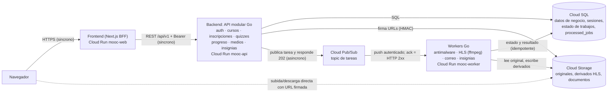
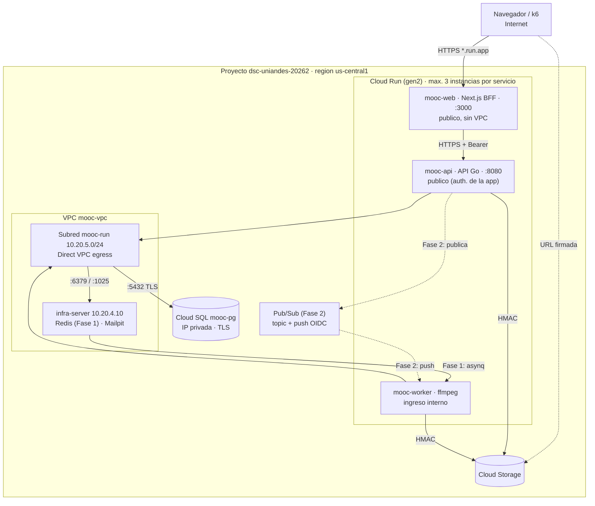

# Entrega 4 - Despliegue en Cloud Run y Cloud Pub/Sub

ISIS4426 - Desarrollo de Soluciones Cloud · Universidad de los Andes · 2026-20

Este documento describe el despliegue de la plataforma MOOC sobre **Cloud
Run** y la integración de **Cloud Pub/Sub** para las tareas asíncronas, y
los cambios frente a la Entrega 3. La arquitectura lógica de la aplicación
(módulos, reglas de negocio, modelo de datos) no cambia y sigue en
[`../entrega1/ARQUITECTURA.md`](../entrega1/ARQUITECTURA.md).

> **Estado del documento (11-11-2026).** La entrega se trabaja en dos fases:
>
> - **Fase 1 (en curso):** frontend y API en Cloud Run, con la cola todavía
>   en Redis (`infra-server`). Script: [`deploy/gcp/cloudrun.sh`](../../deploy/gcp/cloudrun.sh).
> - **Fase 2 (pendiente):** reemplazar Redis/asynq por un topic de Pub/Sub con
>   suscripción push autenticada hacia el servicio `mooc-worker`.
>
> Los valores marcados como _pendiente_ se completan con la salida de
> `./deploy/gcp/cloudrun.sh resumen` una vez desplegado. Lo descrito para la
> Fase 2 es el **diseño previsto**, no lo desplegado.

Documentos relacionados: arquitectura de la Entrega 3
([`../entrega3/arquitectura.md`](../entrega3/arquitectura.md)) y deuda técnica
([`../entrega3/deuda-tecnica.md`](../entrega3/deuda-tecnica.md)).

## 1. Cambios frente a la Entrega 3

| Componente | Entrega 3 | Entrega 4 |
|---|---|---|
| Frontend | MIG `mooc-web`, 1 VM `e2-small` | Servicio Cloud Run **`mooc-web`**, 0 a 3 instancias |
| API | MIG `mooc-api`, 1 a 3 VMs, autoescalado por CPU 60 % | Servicio Cloud Run **`mooc-api`**, 0 a 3 instancias, autoescalado por solicitudes concurrentes |
| Workers | MIG `mooc-worker`, 1 a 3 VMs, autoescalado por `queue_backlog` | Servicio Cloud Run **`mooc-worker`**, máximo 3 instancias, escalado por los mensajes que entrega Pub/Sub (Fase 2) |
| Cola | Redis + asynq en `infra-server` (el worker *busca* trabajos) | **Pub/Sub**: topic + suscripción push (Pub/Sub *entrega* cada mensaje al worker) — Fase 2. En la Fase 1 sigue Redis |
| Acceso público | Balanceador HTTPS externo con certificado administrado | URL HTTPS propia de cada servicio (`*.run.app`, certificado de Google). El balanceador de la Entrega 3 ya no se usa |
| Inicialización | Plantilla de instancia + `startup.sh` | Cloud Run arranca el contenedor directamente desde Artifact Registry; no hay VMs que preparar |
| Red privada | VMs dentro de `mooc-vpc` | **Direct VPC egress** desde la subred nueva `mooc-run` hacia Cloud SQL y `infra-server` |
| Secretos | Un `.env` completo por rol (`mooc-<rol>-env`) | **Un secreto por valor sensible** (`mooc-run-*`), inyectado por Cloud Run como variable de entorno |
| Persistencia | Cloud SQL y Cloud Storage | **Igual** (mismas instancias y bucket) |

**Cambios en el código:** ninguno en las reglas de negocio para la Fase 1. La
configuración de Cloud Run se hace solo con variables de entorno (sección 7).
La Fase 2 cambiará el productor (la API publicará en Pub/Sub) y el
consumidor (el worker expondrá un endpoint HTTP que recibe el push).

## 2. Correspondencia entre el enunciado y los servicios de GCP

| Requisito | Servicio / recurso | Estado |
|---|---|---|
| Tres servicios independientes con imágenes en Artifact Registry | Cloud Run `mooc-web`, `mooc-api`, `mooc-worker`; imágenes `us-central1-docker.pkg.dev/dsc-uniandes-20262/mooc/{web,api,worker}:<sha>` | web y api: Fase 1 · worker: Fase 2 |
| Máximo 3 instancias, un contenedor por instancia | `--max-instances=3` en cada servicio; Cloud Run ejecuta un contenedor de aplicación por instancia | Configurado en el script |
| Réplicas sin estado local | Datos en Cloud SQL, archivos en Cloud Storage; `/tmp` solo para temporales reconstruibles | Igual que la Entrega 3 |
| Frontend conectado al backend, CORS y autenticación | BFF de Next.js con `API_BASE_URL` = URL de `mooc-api`; cookie `HttpOnly` + Bearer | Fase 1 |
| Backend y workers con Cloud SQL y Cloud Storage | Direct VPC egress a la IP privada de `mooc-pg`; llaves HMAC por rol para el bucket | Fase 1 |
| Topic y suscripción push autenticada | Pub/Sub, suscripción push con token OIDC de una cuenta de servicio dedicada | Fase 2 |
| Workers protegidos por IAM | `mooc-worker` con `--ingress=internal` y sin invocación pública; `roles/run.invoker` solo para la identidad de la suscripción | Fase 2 |
| Secretos en Secret Manager | `mooc-run-*`, acceso por cuenta de servicio | Fase 1 |

## 3. Modelo de componentes

Fuente: [`diagramas/componentes.mmd`](diagramas/componentes.mmd) (objetivo de la Fase 2).



| Componente | Responsabilidad | Comunicación |
|---|---|---|
| `mooc-web` | Interfaz y BFF: guarda el token en la cookie `HttpOnly` `mooc_session` y llama a la API del lado del servidor | Síncrona con la API (HTTPS) |
| `mooc-api` | Reglas de negocio, autenticación, autorización, firma de URLs; publica tareas sin esperar su ejecución | Síncrona con Cloud SQL; asíncrona hacia Pub/Sub |
| Pub/Sub | Desacopla productor y consumidor; reintenta la entrega hasta recibir confirmación | Push HTTP autenticado hacia el worker |
| `mooc-worker` | Antimalware, transcodificación HLS, correos, insignias; persiste estado y resultado | Recibe push; escribe en Cloud SQL y Cloud Storage |
| Cloud SQL | Fuente de verdad: negocio, sesiones, estado de trabajos, idempotencia (`processed_jobs`) | — |
| Cloud Storage | Originales, derivados HLS y documentos | El navegador sube y descarga directo con URL firmada |

## 4. Modelo de despliegue

Fuente: [`diagramas/despliegue.mmd`](diagramas/despliegue.mmd).



### 4.1 Red

| Elemento | Valor | Uso |
|---|---|---|
| VPC | `mooc-vpc` (la misma de las Entregas 2 y 3) | — |
| Subred `mooc-run` | `10.20.5.0/24`, `us-central1`, Private Google Access | IPs de las instancias de Cloud Run con Direct VPC egress |
| Modo de salida | `--vpc-egress=private-ranges-only` | Solo el tráfico a rangos privados (Cloud SQL, `infra-server`) entra a la VPC. Cloud Storage y la URL pública de la API salen directo, sin Cloud NAT |
| Etiquetas de red | `mooc-api` en la API, `mooc-worker` en el worker | Reutilizan la regla `mooc-allow-app-to-infra` de la Entrega 3 (6379 y 1025 hacia `infra-server`) |
| Cloud SQL | IP privada en `mooc-psa`, `sslmode=require` | Sin cambios |

`mooc-web` no se conecta a la VPC: solo habla con la URL pública de la API.

### 4.2 Configuración de los servicios de Cloud Run

Valores configurados en [`deploy/gcp/cloudrun.sh`](../../deploy/gcp/cloudrun.sh)
(se pueden cambiar con variables de entorno, p. ej. `API_MIN=1`). Verificar
con `./deploy/gcp/cloudrun.sh resumen`.

| Parámetro | `mooc-web` | `mooc-api` | `mooc-worker` |
|---|---|---|---|
| Región | `us-central1` | `us-central1` | `us-central1` |
| Entorno de ejecución | gen2 | gen2 | gen2 |
| Mínimo de instancias | 0 | 0 | 1 (Fase 1, temporal) · _Fase 2: pendiente_ |
| Máximo de instancias | **3** | **3** | **3** |
| CPU | 1 vCPU | 1 vCPU | 2 vCPU |
| Memoria | 512 MiB | 512 MiB | 4 GiB |
| Concurrencia por instancia | 80 | 80 | _Fase 2: pendiente_ |
| Tiempo máximo de solicitud | 60 s | 60 s | _Fase 2: pendiente_ |
| Puerto del contenedor | 3000 | 8080 | 9100 (`/healthz`) en Fase 1 |
| Asignación de CPU | Solo durante solicitudes, con *startup boost* | Solo durante solicitudes, con *startup boost* | Siempre asignada (Fase 1) |
| Ingreso / invocación | Público | Público | Interno, sin invocación pública |
| Cuenta de servicio | `mooc-web` | `mooc-api` | `mooc-worker` |
| URL | _pendiente_ | _pendiente_ | — |

**Justificación de los valores:**

- **Mínimo 0 en web y API.** No se pagan instancias sin tráfico. El costo es
  un arranque en frío en la primera solicitud. Para la demostración o las
  pruebas de carga se puede subir a 1 (`API_MIN=1`).
- **Concurrencia 80 en la API.** Es el valor por defecto de Cloud Run. Con un
  pool de 20 conexiones a Postgres por instancia (`DB_MAX_OPEN_CONNS`), 3
  instancias usan como máximo 60 conexiones, por debajo del límite de Cloud
  SQL. En la Entrega 3 el límite de capacidad fue Cloud SQL, no la API.
- **Timeout de 60 s.** Las cargas y descargas de archivos no pasan por la API
  (van directo al bucket con URL firmada).
- **Worker con 4 GiB.** En Cloud Run el disco local (`/tmp`) vive en memoria,
  así que los temporales de ffmpeg cuentan contra el límite.

### 4.3 Servicios administrados

| Servicio | Recurso | Cambio frente a la Entrega 3 |
|---|---|---|
| Cloud SQL | `mooc-pg`, PostgreSQL 16, `db-custom-1-3840`, IP privada | Ninguno |
| Cloud Storage | `gs://mooc-dsc-uniandes-20262`, CORS `GET/HEAD/PUT` | Ninguno |
| Artifact Registry | Repositorio `mooc` | Se agregan las imágenes del commit de la Entrega 4 |
| Secret Manager | `mooc-run-*` | Nuevos (sección 7.2) |
| `infra-server` | Redis, Mailpit | Se mantiene en la Fase 1. En la Fase 2 deja de ser la cola |

## 5. Escalamiento

- Cloud Run crea instancias según las **solicitudes en curso** frente a la
  concurrencia configurada (y el uso de CPU), y las retira cuando quedan
  inactivas. No hay política que configurar aparte del mínimo, el máximo y
  la concurrencia.
- El requisito se verifica sobre el **límite configurado** (`maxScale=3`).
  Según la documentación de Cloud Run, el número real puede superarlo
  brevemente.
- **Workers (Fase 2):** Pub/Sub envía cada mensaje como una solicitud HTTP;
  con más mensajes pendientes hay más solicitudes simultáneas y Cloud Run
  crea más instancias, hasta 3. La concurrencia del worker se fijará baja
  (del orden de 1 a 2 transcodificaciones por instancia, como el
  `WORKER_CONCURRENCY=2` de la Entrega 3) para que más mensajes signifiquen
  más instancias y no más trabajos en la misma CPU.
- **Verificación prevista:** carga controlada con k6 contra la API y
  publicación de varios trabajos multimedia, observando en Cloud Monitoring
  `run.googleapis.com/container/instance_count` por servicio y
  `pubsub.googleapis.com/subscription/num_undelivered_messages`. _Evidencia
  pendiente._

## 6. Tareas asíncronas

### 6.1 Fase 1 (transitoria): Redis y asynq

Mientras se implementa Pub/Sub, la API sigue encolando en Redis
(`infra-server`). El worker de asynq **busca** trabajos en Redis por su
cuenta, un modelo que no encaja con Cloud Run (diseñado para servicios que
reciben solicitudes). Para probar el flujo completo existe el paso opcional
`cloudrun.sh worker-temporal`, con CPU siempre asignada y mínimo 1 instancia.
Esa versión **no escala por la cola** y no satisface el criterio de Pub/Sub:
es solo un puente.

### 6.2 Fase 2 (diseño previsto): Pub/Sub

| Elemento | Diseño |
|---|---|
| Topic | Uno para las tareas (antimalware, HLS, correo, insignias), con el tipo en un atributo del mensaje |
| Suscripción | Push hacia un endpoint del servicio `mooc-worker`, con **token OIDC** de una cuenta de servicio dedicada a la suscripción |
| Publicación | La API publica la tarea y responde sin esperar (como hoy con asynq). El estado inicial queda en Cloud SQL |
| Confirmación (ack) | El worker responde `2xx` **solo después** de persistir estado y resultado. Un error responde `5xx` y Pub/Sub reintenta |
| Reentregas | Se reutilizan las tres capas de idempotencia de la Entrega 3: llave por tarea (`scan:<asset>`, `hls:<asset>`), tabla `processed_jobs` y restricciones únicas en Postgres. Los derivados HLS se reescriben en las mismas llaves del bucket |
| Reintentos agotados | Topic de mensajes fallidos (*dead-letter*) y estado `failed` diagnosticable en la base |
| Verificar la finalización | El frontend ya consulta el estado del asset (`GET /assets/:id`) |

**Tiempos a compatibilizar (decisión pendiente):** en una suscripción push el
plazo de confirmación es de **como máximo 600 s**, mientras que la
transcodificación más larga de la Entrega 3 (P3) tardó unos 8 minutos. Si el
procesamiento supera el plazo, Pub/Sub reentrega el mensaje mientras el
primer worker sigue trabajando. Opciones: fijar el plazo en 600 s y el
timeout del worker por encima de la duración esperada, y asegurar que un
segundo intento simultáneo **detecte el trabajo en curso** (marca en
`processed_jobs` antes de empezar) en lugar de duplicarlo.

## 7. Configuración y acceso

### 7.1 Identidades

| Cuenta de servicio | Uso en la Entrega 4 | Permisos relevantes |
|---|---|---|
| `mooc-web` | Identidad de `mooc-web` | Logs y métricas. Sin acceso a secretos `mooc-run-*` ni al bucket |
| `mooc-api` | Identidad de `mooc-api` | `secretAccessor` solo sobre `mooc-run-database-url`, `-redis-password`, `-admin-password`, `-s3-secret-api`; permisos sobre el bucket de la Entrega 2 (crea y lee, **no borra**). Fase 2: `pubsub.publisher` solo sobre el topic |
| `mooc-worker` | Identidad de `mooc-worker` | `secretAccessor` sobre `mooc-run-database-url`, `-redis-password`, `-s3-secret-worker`; `storage.objectUser` en el bucket |
| Cuenta de la suscripción push (Fase 2) | Firma el token OIDC del push | `roles/run.invoker` **solo** sobre `mooc-worker` |

- `mooc-api` y `mooc-web` son públicos en Cloud Run (`allUsers` como
  invocador) porque la autenticación la hace la aplicación (token opaco
  revocable). La API valida el token en cada solicitud, en cualquier réplica.
- `mooc-worker` no admite invocación pública: solo la identidad de la
  suscripción puede llamarlo.
- La aplicación sigue autenticándose ante Postgres con usuario y contraseña
  (`DATABASE_URL`) y TLS; la cuenta de servicio no autoriza nada ante
  Postgres.

### 7.2 Variables y secretos

- **Configuración no sensible** (`APP_ENV`, `REDIS_ADDR`, `S3_BUCKET`,
  `S3_ACCESS_KEY`, TTLs, límites…): variables de entorno de cada servicio.
  `cloudrun.sh` las toma del `.env` de la Entrega 3 guardado en Secret
  Manager, para no duplicar la configuración, y cambia solo lo propio de
  Cloud Run (`PUBLIC_BASE_URL`, `API_BASE_URL`, tamaño del pool,
  `WORKER_SHUTDOWN_TIMEOUT_SECONDS=8`).
- **Secretos**, uno por valor, inyectados con `--set-secrets`:

| Secreto | Variable | Lo leen |
|---|---|---|
| `mooc-run-database-url` | `DATABASE_URL` | api, worker |
| `mooc-run-redis-password` | `REDIS_PASSWORD` | api, worker |
| `mooc-run-admin-password` | `ADMIN_PASSWORD` | api |
| `mooc-run-s3-secret-api` | `S3_SECRET_KEY` | api |
| `mooc-run-s3-secret-worker` | `S3_SECRET_KEY` | worker |

Ningún valor sensible queda en el repositorio, en las imágenes ni en la
salida del script. Los archivos temporales del script se crean en una
carpeta privada que se borra al terminar.

### 7.3 Frontend, sesión y CORS

| Dato | Valor |
|---|---|
| Conexión con la API | Del lado del servidor: `API_BASE_URL=https://mooc-api-<número de proyecto>.us-central1.run.app/api/v1` |
| Sesión | Cookie `HttpOnly` y `Secure` `mooc_session` en el dominio de `mooc-web`; el BFF llama a la API con `Authorization: Bearer` |
| CORS en la API | **No aplica**: el navegador nunca llama a la API, solo a los Route Handlers del BFF (mismo origen). Por eso los dos dominios `*.run.app` distintos no afectan la sesión |
| CORS en Cloud Storage | Necesario y ya configurado (`GET/HEAD/PUT`, [`deploy/gcp/cors.json`](../../deploy/gcp/cors.json)) |

## 8. Operación

### 8.1 Despliegue desde cero (Fase 1)

Requisitos: la base de la Entrega 3 (`provision.sh elastica`), `infra-server`
encendida y Cloud SQL activa.

```bash
export PROJECT=dsc-uniandes-20262
./deploy/gcp/build.sh api web worker   # imagenes del commit actual (exige arbol limpio)
./deploy/gcp/cloudrun.sh todo          # apis, red, secretos, api, web y resumen
# Opcional, solo para probar el flujo completo antes de Pub/Sub:
./deploy/gcp/cloudrun.sh worker-temporal
```

### 8.2 Versión nueva

```bash
git commit ...
./deploy/gcp/build.sh api web
./deploy/gcp/cloudrun.sh api web
```

Cada despliegue crea una revisión nueva de Cloud Run; el tráfico pasa a ella
cuando arranca sana. Una revisión anterior se puede recuperar desde la
consola (pestaña **Revisiones**).

### 8.3 Verificación

- `GET <URL de mooc-api>/healthz` → `200`.
- Iniciar sesión desde `<URL de mooc-web>` y completar el recorrido
  profesor–estudiante de la Entrega 3.
- Logs: Cloud Run → servicio → **Registros**.

### 8.4 Relación con la infraestructura de la Entrega 3

Los grupos `mooc-api`, `mooc-worker` y `mooc-web` quedaron con autoescalado
desactivado y **0 instancias** (11-11-2026); plantillas, balanceador y
configuración se conservan para una eventual sustentación de la Entrega 3.
`infra-server`, Cloud SQL y el bucket siguen activos porque la Entrega 4 los
usa.

## 9. Limitaciones y deuda técnica identificada

| Tema | Detalle | Tratamiento previsto |
|---|---|---|
| `TRUSTED_PROXIES` | Se quitó: los rangos eran los del balanceador de la Entrega 3. Gin vuelve a confiar en cualquier `X-Forwarded-For`, lo que permite falsear la IP ante el límite de tasa | Verificar en los logs qué IP de conexión ve la API en Cloud Run y fijar los rangos correspondientes |
| Límite de tasa por IP | Todas las solicitudes de usuarios llegan a la API desde el BFF, así que comparten límite (igual que en la Entrega 3) | Reenviar la IP del usuario desde el BFF o limitar por usuario |
| Endpoints operativos públicos | `/metrics`, `/readyz` y `/docs` quedan accesibles en la URL pública de `mooc-api` (en la Entrega 3 `/metrics` no pasaba por el balanceador) | Desactivar `/metrics` en producción o protegerlo |
| Redis (Fase 1) | Sigue siendo punto único de falla y la API no arranca sin él | Desaparece como cola en la Fase 2; evaluar si la caché de sesiones y el límite de tasa siguen dependiendo de él |
| Worker temporal | CPU siempre asignada y sin escalamiento por cola; se cobra todo el tiempo | Reemplazarlo por el worker push de la Fase 2 |
| Apagado en Cloud Run | 10 s entre SIGTERM y SIGKILL (en la Entrega 3 eran ~90 s) | Con Pub/Sub, un trabajo interrumpido no se confirma y se reentrega |
| Arranque en frío | Con mínimo 0, la primera solicitud tras inactividad es más lenta | `min-instances=1` durante pruebas y demostración |

## 10. Evidencias pendientes

- [ ] URLs de `mooc-web` y `mooc-api` y salida de `cloudrun.sh resumen` (límites de instancias).
- [ ] Recorrido profesor–estudiante desde el navegador sobre Cloud Run.
- [ ] Fase 2: topic, suscripción y permisos en el script; registros que sigan una tarea desde su publicación hasta su finalización.
- [ ] Reentrega de un mensaje sin efectos duplicados.
- [ ] Métricas de instancias ante solicitudes concurrentes y mensajes pendientes, con carga controlada.
- [ ] Video de sustentación (máximo 20 minutos).

## 11. Archivos fuente

| Archivo | Contenido |
|---|---|
| [`diagramas/componentes.mmd`](diagramas/componentes.mmd), [`diagramas/despliegue.mmd`](diagramas/despliegue.mmd) | Diagramas Mermaid (para SVG: `npx -p @mermaid-js/mermaid-cli mmdc -i <archivo>.mmd -o <archivo>.svg`) |
| [`deploy/gcp/cloudrun.sh`](../../deploy/gcp/cloudrun.sh) | Red, secretos y despliegue de los servicios de Cloud Run |
| [`deploy/gcp/build.sh`](../../deploy/gcp/build.sh) | Construcción y publicación de imágenes etiquetadas con el commit |
| [`deploy/gcp/provision.sh`](../../deploy/gcp/provision.sh) | Base heredada de la Entrega 3: VPC, Cloud SQL, bucket, identidades, `infra-server` |
